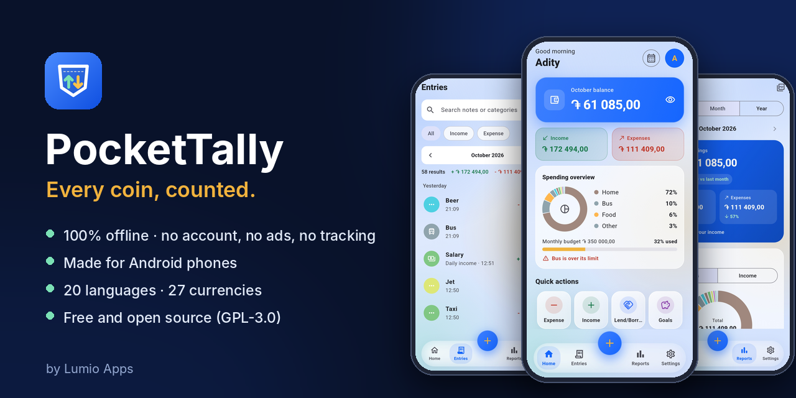
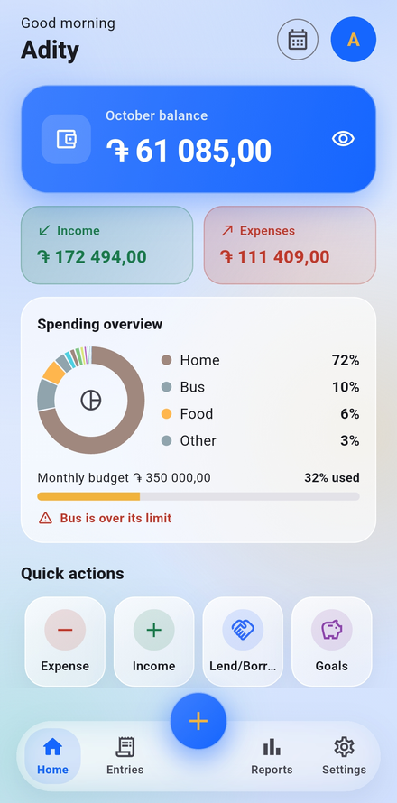
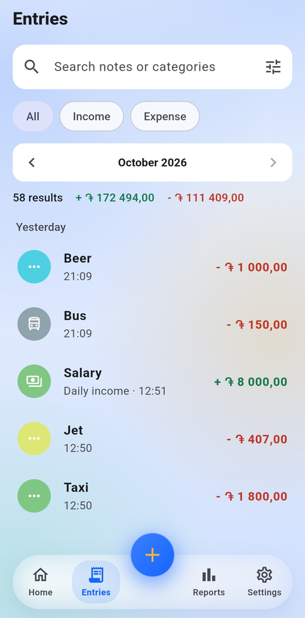
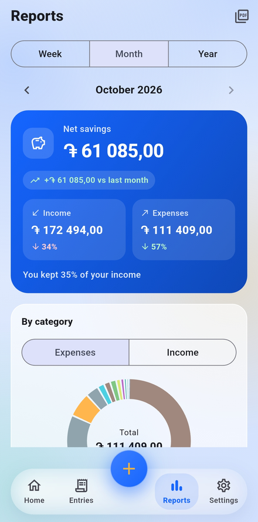
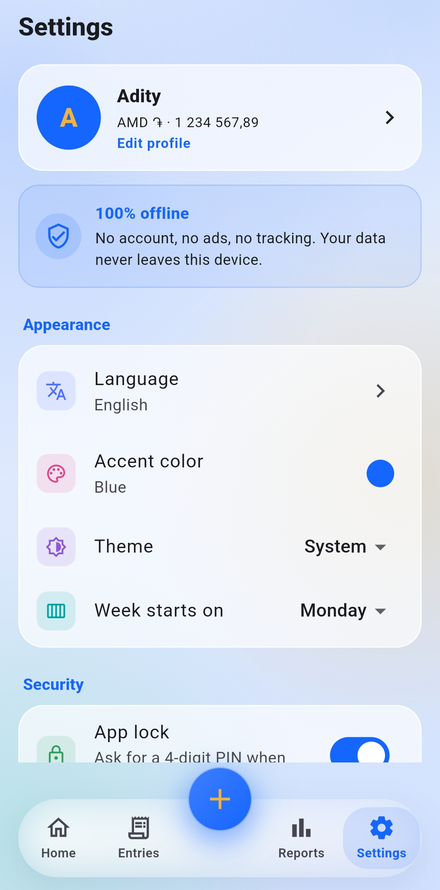
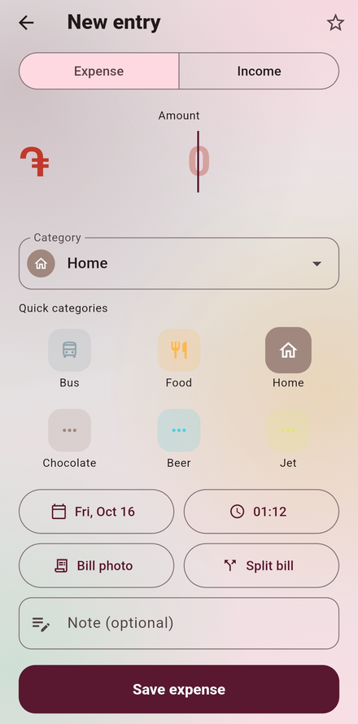
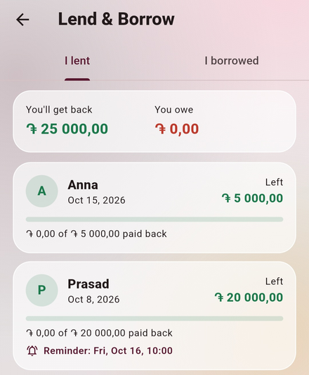
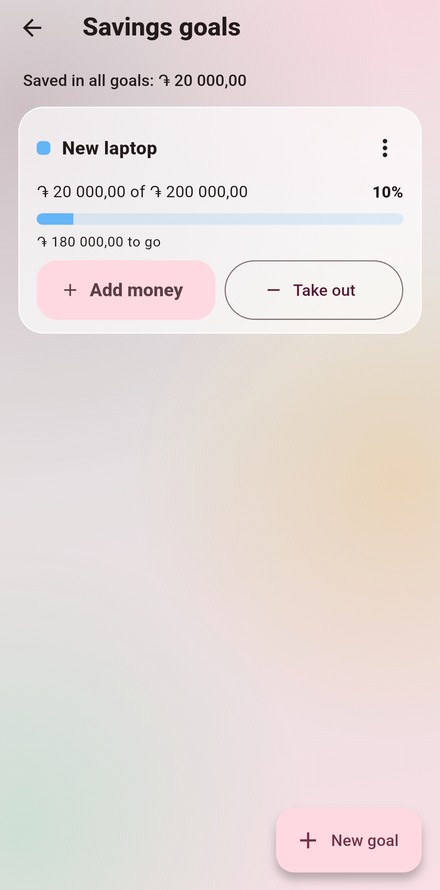
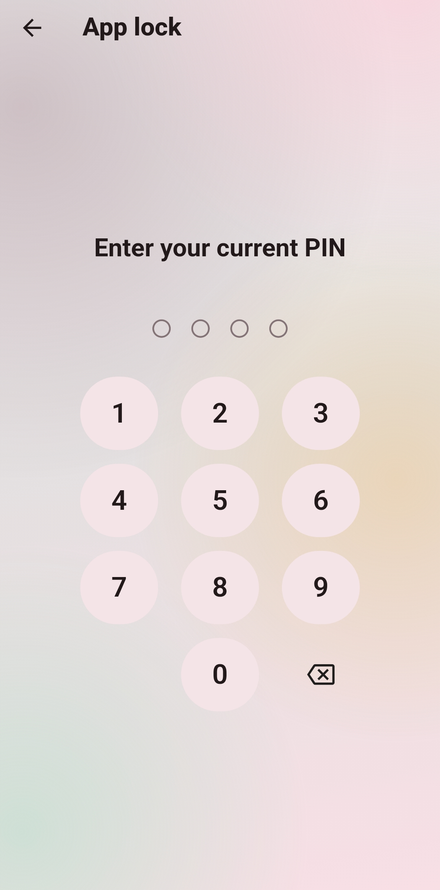

<p align="center">
  
</p>

<h1 align="center">PocketTally</h1>

<p align="center">
  <b>Every coin, counted.</b><br>
  A simple income and expense tracker that works completely offline.<br>
  No account, no ads, no tracking, and not even an internet permission.
</p>

<p align="center">
  <a href="https://github.com/lumio-apps/pockettally/releases/latest"></a>
  
  
  
  <a href="LICENSE"></a>
</p>

<p align="center">
  <a href="#download">Download</a> ·
  <a href="#screenshots">Screenshots</a> ·
  <a href="#features">Features</a> ·
  <a href="#privacy">Privacy</a> ·
  <a href="#build-from-source">Build from source</a>
</p>

---

## Download

Get the APK from the **[latest release](https://github.com/lumio-apps/pockettally/releases/latest)**:

📱 `pockettally-vX.Y.Z-android.apk` – works on every phone with Android 7.0 or newer.

1. Open the file on your phone and allow "Install unknown apps" for your browser or file manager when Android asks.
2. To update, install the newer APK over the old one. Your data stays.

PocketTally has **no update check and no internet access**, so a new version only reaches you when you install it yourself (or through the store you got the app from).

> Moving to a new phone? Use **Settings › Back up data** on the old one and **Restore from backup** on the new one.

## Screenshots

<table>
  <tr>
    <td align="center" valign="top"><br><sub><b>Home</b><br>balance, spending, budget</sub></td>
    <td align="center" valign="top"><br><sub><b>Entries</b><br>search and filter</sub></td>
    <td align="center" valign="top"><br><sub><b>Reports</b><br>week, month, year</sub></td>
    <td align="center" valign="top"><br><sub><b>Settings</b><br>language, theme, backup</sub></td>
  </tr>
  <tr>
    <td align="center" valign="top"><br><sub><b>New entry</b><br>in a few taps</sub></td>
    <td align="center" valign="top"><br><sub><b>Lend &amp; Borrow</b><br>who owes whom</sub></td>
    <td align="center" valign="top"><br><sub><b>Savings goals</b><br>with progress</sub></td>
    <td align="center" valign="top"><br><sub><b>App lock</b><br>4-digit PIN</sub></td>
  </tr>
</table>

The look is frosted glass on a soft gradient in the colors of the accent color you pick (six to choose from), in light and dark mode.

## Why PocketTally

- **Private by design.** No sign-up, no cloud, no ads, no analytics. The app has no internet permission at all, so it cannot send anything anywhere. Your data sits in a database on your phone.
- **Quick.** Add an expense in a few seconds, split a bill with friends, keep track of money you lent, and see where your money went this month.
- **For everyone.** 20 languages (10 of them Indian), 27 currencies and local number formats like 12,34,567.89.
- **Free forever.** Open source under GPL-3.0. No premium version, no locked features.

## Features

**Track**
- Income (daily, weekly or monthly) and expenses in one list
- Quick add with the **+** button: expense, income, lend/borrow or savings goal
- Simple math in the amount field (`120+45`), and **duplicate** any entry
- **Recurring entries** like salary or rent, added automatically
- **Favorites** for one-tap entries, **tags** like `#trip`, and **bill photos**

**Understand**
- Monthly balance, income and expenses on Home
- **Reports** for any week, month or year: net savings, the change from the period before, a donut by category and income vs expenses over time
- **Highlights** like "You spent 12% less than last month"
- **Calendar** view and **upcoming bills**
- **Search and filter** by text, type, category, date and amount
- **PDF report** in your language: pick the period (also a whole year), the entries, categories and sections; made on your phone

**Plan**
- **Budgets:** a monthly limit and a limit per category, with warnings, and optional carry-over of what's left
- **Lend & Borrow:** who owes you, whom you owe, part payments, and reminders to ask for the money or pay it back
- **Split bill:** share an expense with friends, equally or with your own amounts; your share is the expense, the rest goes to Lend & Borrow
- **Savings goals** with progress

**Your data, your way**
- **Backup and restore** to a file you choose, with or without bill photos
- **Auto backup** every day or week, the last 5 kept
- **CSV export and import** for Excel, LibreOffice or Google Sheets
- **Categories:** add, rename, recolor, reorder, hide or delete

**Private and handy**
- **App lock** with a 4-digit PIN
- **Daily reminder** on days you haven't added anything
- **Home screen widgets** with this month's balance and − / + buttons
- **Shortcuts:** long-press the app icon for "Add expense" or "Add income"

**Make it yours**
- A **profile** with your photo and name
- **20 languages:** English, हिन्दी, Հայերեն, 中文, Español, العربية, Français, বাংলা, Português, Русский, اردو, Bahasa Indonesia, 日本語, ગુજરાતી, தமிழ், తెలుగు, मराठी, ಕನ್ನಡ, മലയാളം, ਪੰਜਾਬੀ
- **27 currencies** and number formats: 1,234.56 · 1.234,56 · 1 234,56 · 1'234.56 · 12,34,567.89
- Light, dark or system theme and six accent colors
- Week starts on Monday or Sunday
- Wide layout with a sidebar on tablets and big screens

## Privacy

- Everything is stored on your device in a local database.
- No account, no ads, no analytics, no tracking.
- The app has no internet permission at all: it cannot send anything anywhere.
- The app lock PIN is stored only as a salted hash, never as the PIN itself.
- Backups, CSV files and PDF reports are saved only where you choose.

Read the full [Privacy Policy](PRIVACY.md).

## Translations

Texts live in `lib/l10n/app_<language>.arb`. To fix a translation, edit the line in that file and open a pull request. The app code is generated from these files by `flutter pub get`.

## Build from source

You need [Flutter](https://docs.flutter.dev/get-started/install) (stable channel).

```
flutter pub get
flutter analyze
flutter test
flutter build apk --release
```

The `android/` folder, the app icon and the splash screen are generated by GitHub Actions. Release signing setup: see [SETUP_ANDROID.md](SETUP_ANDROID.md).

Each `vX.Y.Z` tag builds the release files. Before tagging, raise `version:` in `pubspec.yaml` to the same number.

## Contributing

Bug reports, translation fixes and ideas are welcome: [open an issue](https://github.com/lumio-apps/pockettally/issues) or send a pull request. The app stays offline, without ads or tracking, so features that need the internet will not be added.

## License

[GPL-3.0](LICENSE). The bundled DejaVu fonts use their own free license, see `assets/fonts/DejaVu-LICENSE.txt`.

<p align="center"><sub>Made by <b>Lumio Apps</b></sub></p>
