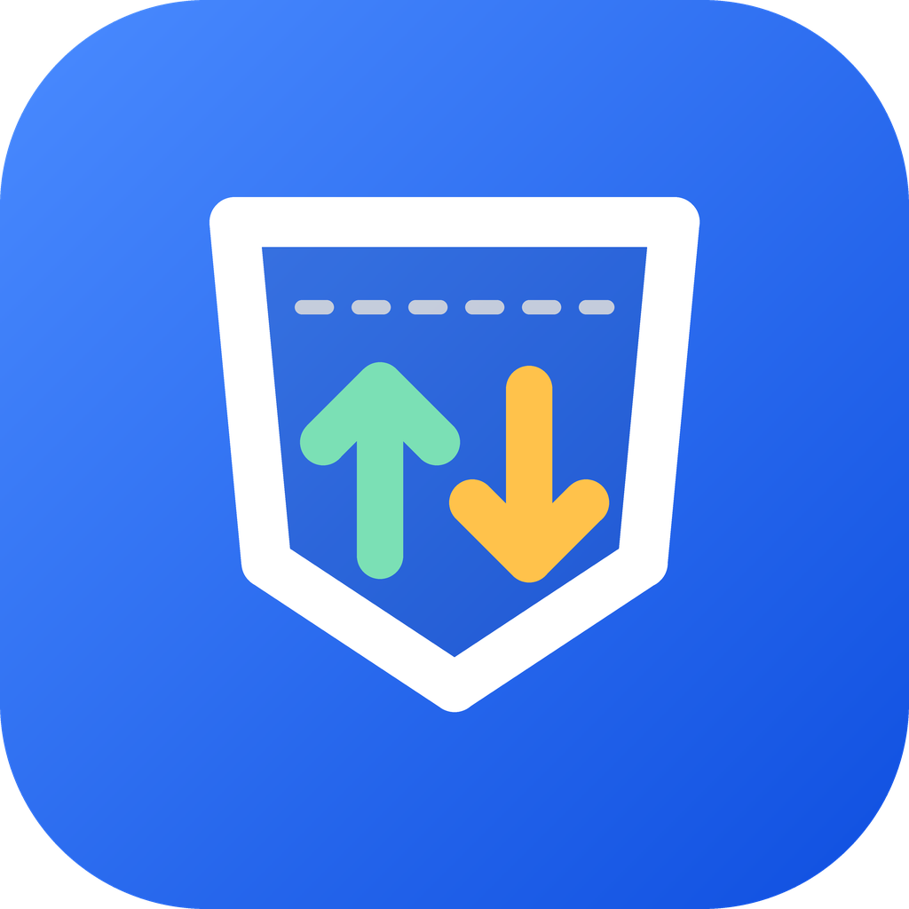

<p align="center">
  
</p>

<h1 align="center">PocketTally</h1>

<p align="center">
  A simple, offline daily income and expense tracker for Android.<br>
  Part of the Lumio Apps family. No account, no ads, no tracking.
</p>

## Features

- Add income (daily, weekly or monthly) and daily expenses
- Income and expenses in one list, each entry separate (income green, expense red)
- Monthly balance, income and expenses on the home screen
- **Categories:** create your own, rename, recolor, reorder, hide or delete them
- **Stats:** totals for any day, week, month or year, a pie chart by category and a month-by-month bar chart
- **PDF report** of any period, made on the phone
- **Search and filter:** by text, type, category, date range and amount
- **Budgets:** a monthly limit and a limit per category, with warnings
- **Calculator** in the amount field (120+45)
- **Lend & Borrow:** who owes you, whom you owe, part payments
- **Savings goals** with progress
- **Bill photos** attached to entries, stored only in the app
- **Backup and restore** to a file you choose, nothing is uploaded
- Week starts on Monday or Sunday
- Edit entries, swipe to delete with Undo
- One app-wide currency (INR, USD, EUR, AMD and many more), changeable in Settings
- Number format (1,234.56, 1.234,56, 1 234,56, 1'234.56, 12,34,567.89) and decimals on or off
- Light, dark or system theme, and five accent colors
- In-app "Check for updates" that downloads new releases from GitHub

## Download

Get the latest APK from [Releases](https://github.com/lumio-apps/pockettally/releases):

| File | For |
|---|---|
| `…-arm64-v8a.apk` | Almost all phones from the last 7–8 years |
| `…-armeabi-v7a.apk` | Older or low-cost phones (32-bit) |
| `…-x86_64.apk` | Emulators and some tablets |
| `…-universal.apk` | Any device (bigger file) |

Not sure? Take the universal APK. After that, "Check for updates" in the app
picks the smaller file for your phone by itself. Once a phone has a
processor-specific APK installed, update it with the same kind of file
(or through the app), not with the universal one.

## Privacy

All data stays on your phone in a local database.
The `INTERNET` permission is used only when you tap "Check for updates",
which contacts the GitHub Releases page of this project.

## Build

```
flutter pub get
flutter analyze
flutter test
```

The `android/` folder, app icon and splash screen are generated by
GitHub Actions. Release signing setup: see [SETUP_ANDROID.md](SETUP_ANDROID.md).

F-Droid build without the updater:

```
flutter build apk --dart-define=UPDATER=false
```

## License

[GPL-3.0](LICENSE). The bundled DejaVu fonts use their own free license, see `assets/fonts/DejaVu-LICENSE.txt`.
