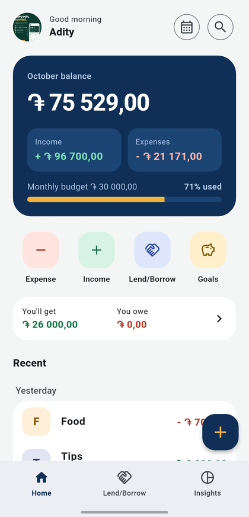
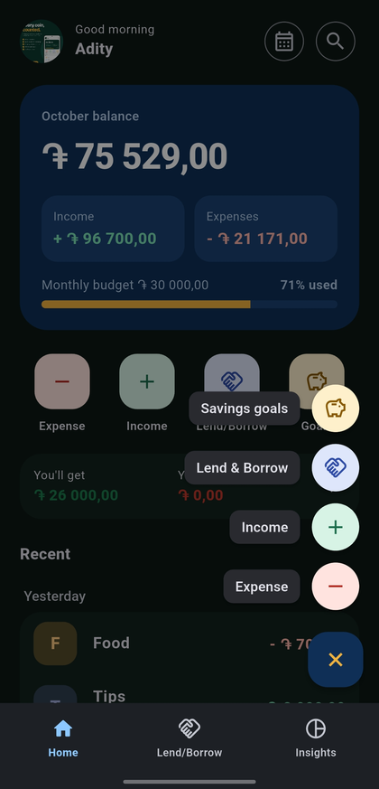
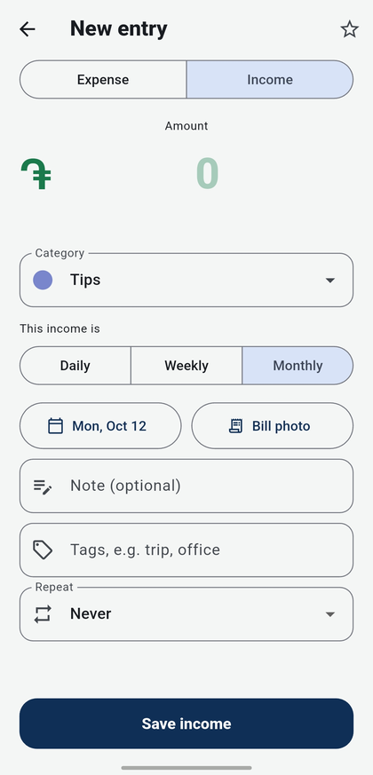
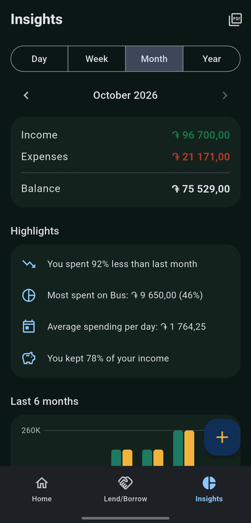
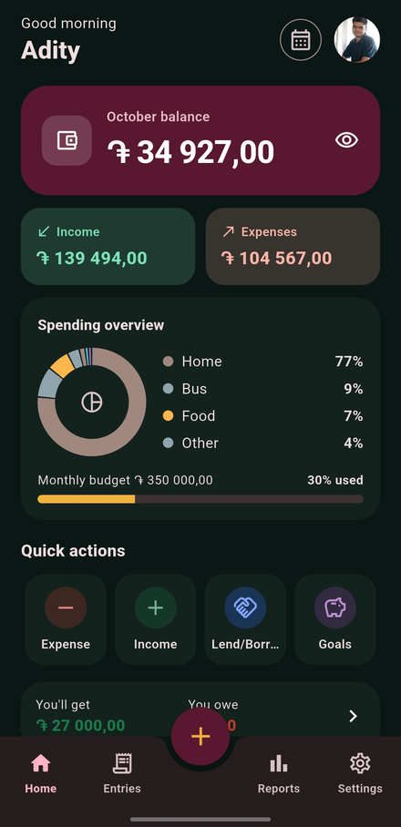
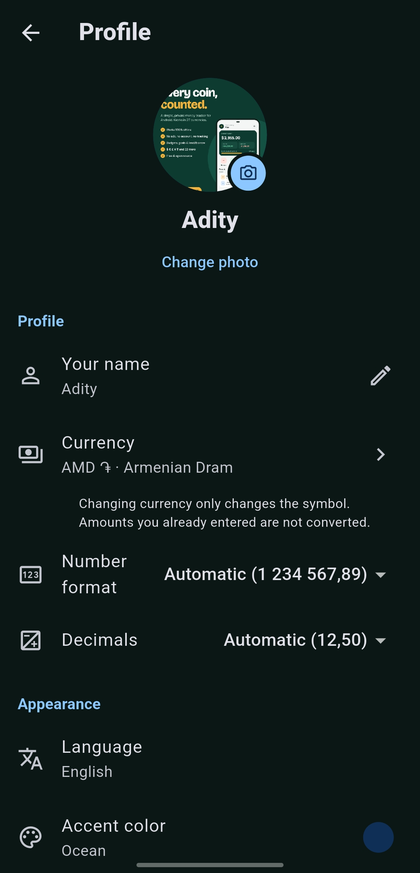

<p align="center">
  
</p>

<p align="center">
  <a href="https://github.com/lumio-apps/pockettally/releases/latest"></a>
  
  <a href="LICENSE"></a>
</p>

<p align="center">
  A simple daily income and expense tracker that works completely offline.<br>
  No account, no ads, no tracking. Your money data never leaves your device.<br>
  Part of the <b>Lumio Apps</b> family.
</p>

---

## Download

| System | File to take from [the latest release](https://github.com/lumio-apps/pockettally/releases/latest) |
|---|---|
| 📱 **Android** | `pockettally-vX.Y.Z-android.apk` – works on every phone |
| 🪟 **Windows** | `pockettally-vX.Y.Z-windows-setup.exe` – installs for your user, no admin rights |
| 🐧 **Linux** | `pockettally-vX.Y.Z-linux-x86_64.AppImage` – one file, no install |

After the first install the app keeps itself up to date: **Settings › Check for updates**.

<details>
<summary>Install notes</summary>

- **Android:** allow "Install unknown apps" for your browser or file manager when asked.
  The APK installs over any earlier PocketTally, your data stays.
- **Windows:** Windows may say "Windows protected your PC" because the app is not
  signed with a paid certificate. Click **More info → Run anyway**.
- **Linux:** make the file executable (`chmod +x pockettally-*.AppImage`) and run it.

On a computer the data is kept in your user's app data folder
(`%APPDATA%\Lumio Apps\PocketTally` on Windows,
`~/.local/share/com.lumio.pockettally` on Linux).
Use **Back up / Restore** to move it between a phone and a computer.

</details>

## Screenshots

<table>
  <tr>
    <td align="center"><br><sub>Home</sub></td>
    <td align="center"><br><sub>Add anything with +</sub></td>
    <td align="center"><br><sub>New entry</sub></td>
  </tr>
  <tr>
    <td align="center"><br><sub>Insights and highlights</sub></td>
    <td align="center"><br><sub>Dark theme</sub></td>
    <td align="center"><br><sub>Profile and settings</sub></td>
  </tr>
</table>

## Features

**Track**
- Income (daily, weekly or monthly) and expenses in one list
- Quick add with the **+** button: expense, income, lend/borrow or savings goal
- Simple math in the amount field (`120+45`), and **duplicate** any entry
- **Recurring entries** like salary or rent, added automatically
- **Favorites** for one-tap entries, **tags** like `#trip`, and **bill photos**

**Understand**
- Monthly balance, income and expenses on Home
- **Reports** for any week, month or year: net savings, the change from the
  period before, a donut by category and income vs expenses over time
- **Highlights** like "You spent 12% less than last month"
- **Calendar** view and **upcoming bills**
- **Search and filter** by text, type, category, date and amount
- **PDF report** of any period, made on the device

**Plan**
- **Budgets:** a monthly limit and a limit per category, with warnings, and optional carry-over of what's left
- **Lend & Borrow:** who owes you, whom you owe, part payments, and reminders
  to ask for the money or pay it back (Android)
- **Split bill:** share an expense with friends, equally or with your own
  amounts; your share is the expense, the rest goes to Lend & Borrow
- **Savings goals** with progress

**Your data, your way**
- **Backup and restore** to a file you choose, with or without bill photos
- **Auto backup** every day or week, the last 5 kept
- **CSV export and import** for Excel, LibreOffice or Google Sheets
- **Categories:** add, rename, recolor, reorder, hide or delete

**Private**
- **App lock** with a 4-digit PIN
- **Daily reminder** (Android) on days you haven't added anything

**Make it yours**
- A **profile** with your photo and name
- **13 languages:** English, हिन्दी, Հայերեն, 中文, Español, العربية, Français, বাংলা, Português, Русский, اردو, Bahasa Indonesia, 日本語
- **27 currencies** and number formats: 1,234.56 · 1.234,56 · 1 234,56 · 1'234.56 · 12,34,567.89
- Light, dark or system theme and five accent colors
- Week starts on Monday or Sunday
- Wide layout with a sidebar on computers, keyboard shortcuts **Ctrl+N** (new entry) and **Ctrl+F** (search)

## Privacy

- Everything is stored on your device in a local database.
- No account, no ads, no analytics, no tracking.
- The only network use is **Check for updates**, which asks the GitHub Releases
  page of this project for a newer version.
- The app lock PIN is stored only as a salted hash, never as the PIN itself.
- Backups, CSV files and PDF reports are saved only where you choose.

## Translations

Texts live in `lib/l10n/app_<language>.arb`. To fix a translation, edit the
line in that file and open a pull request. The app code is generated from
these files by `flutter pub get`.

## Build from source

```
flutter pub get
flutter analyze
flutter test
```

The `android/`, `windows/` and `linux/` folders, the app icon and the splash
screen are generated by GitHub Actions. Release signing setup: see
[SETUP_ANDROID.md](SETUP_ANDROID.md).

Build without the in-app updater (for F-Droid):

```
flutter build apk --dart-define=UPDATER=false
```

Each `vX.Y.Z` tag builds the release files for Android, Windows and Linux.
Before tagging, raise `version:` in `pubspec.yaml` to the same number.

## License

[GPL-3.0](LICENSE). The bundled DejaVu fonts use their own free license, see
`assets/fonts/DejaVu-LICENSE.txt`.
